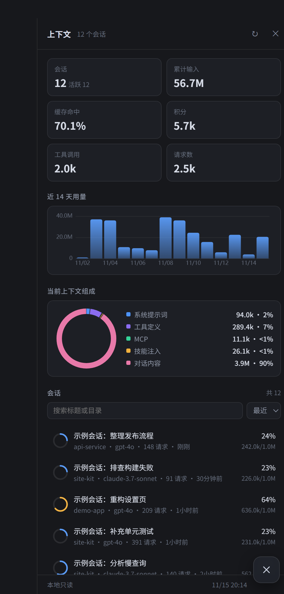

# WorkBuddy 上下文面板

在客户端里查看上下文占用与逐请求明细。数据来自本机的 `~/.workbuddy`，只读。

**非官方项目**，与 WorkBuddy、腾讯没有关系。它通过运行时注入修改界面，
可能违反客户端的服务条款，使用前请自行评估。



## 版本说明

这个面板对应的是 dsh-context 网页版的全部视图。网页版要单独起一个 Python 服务，
再开一个浏览器标签；这里改成客户端内的面板，数据由客户端主进程读取，
关掉面板就不再占用资源，也不会有额外的常驻进程。

5.9.2 起客户端把 renderer 打包进 `app.asar` 并加了 SHA256 完整性校验，
往页面文件里插加载器的做法已经没有入口。5.11.0 改过首页和顶栏，
但主布局 `[data-view-id=main-content]` 与主界面入口 `renderer/index.html` 没有变。

面板走 `--inspect` 注入，不修改客户端安装目录里的任何文件。

## 功能

### 总览

- 六个指标：会话数（含活跃数）、累计输入、缓存命中率、积分、工具调用、请求数
- 近 14 天用量柱状图，悬停显示当天 tokens、请求数与积分
- 当前上下文组成环形图：系统提示词、工具定义、MCP、技能注入、对话内容
- 会话列表：占用环、标题、目录、模型、请求数、相对时间；支持搜索（标题或目录）与排序（最近 / 占用 / 用量）

### 会话详情

- 标题、模型、模式、transcript 大小、请求数 / 轮数
- 四个指标：累计输入、缓存命中、工具调用与总耗时、积分与压缩次数
- 当前上下文堆叠条，以及固定开销、用户输入、注入内容、助手输出、推理、工具返回的逐项占比
- 逐请求趋势图：总量与增量两种口径，压缩点用红色虚线标出，悬停显示该次请求的窗口、分层与缓存
- 请求拆解：下拉选择任意一次请求，查看它的窗口组成
- 工具、文件活动、命令、事件四张表

## 数据口径

与网页版 `core/analyze.py` 一致：

- 一次请求指一条带 `providerData.usage.inputTokens` 的记录，按 `(conversationRequestId, stepSeq)` 去重
- `inputTokens` 是实测值；各分类按文本长度估算后，整体缩放到该次实测总量
- 固定开销 = 首个请求的 `inputTokens` 减去当时可见内容，涵盖系统提示词、工具 schema、技能目录等不落盘的部分
- 积分按 `conversationRequestId` 只计一次
- 压缩判定：`inputTokens` 低于上一次的 75%，或 `providerData.agent` 为 `compact`

token 估算规则：CJK 字符约 0.7 token，其余字符约 0.25 token。它只用于分层占比，
总量以实测 `inputTokens` 为准。

## 安装

需要 WorkBuddy 5.9.2 或更新版本。5.8.x 的 renderer 没有打包，注入入口按路径结尾匹配，见「兼容性」。

1. 下载 Release 中的 zip，解压到任意目录
2. 双击 `install.cmd`
3. 在托盘右键完全退出 WorkBuddy
4. 用原来的图标启动

启动后右下角会出现一个方形按钮，点开即面板。

### 关于快捷方式与开机自启

安装器会接管桌面、开始菜单、任务栏固定项里的 `WorkBuddy.lnk`：把目标改成注入器，
原文件备份为 `WorkBuddy.lnk.wbmods.bak`，图标和名称保持不变。
注册表 `HKCU\...\Run` 里的自启项一并接管，原值备份在 `%LOCALAPPDATA%\WbMods\autostart.json`。

如果不想让官方图标被接管，使用 `install.cmd -KeepOfficialIcon`，
此时只能通过新创建的「WorkBuddy (mods)」快捷方式启动。

开机自启必须接管：Windows 重启时会先用它拉起客户端，如果它还指向原版，
那一轮启动就没有任何 mod，之后再点快捷方式会被单实例锁挡掉。

### 安装目录识别

安装目录可以是任意盘符、任意路径，含中文或空格也可以，不要求目录名是 `WorkBuddy`。
安装器按以下顺序查找，只要目录里存在 `resources\app.asar` 就认定为客户端：

1. 上次安装时记录的路径
2. 正在运行的客户端进程
3. 注册表卸载项（`DisplayIcon`、`InstallLocation`、`UninstallString`）
4. App Paths（HKLM / HKCU，含 WOW6432Node）
5. 桌面、公共桌面、开始菜单、任务栏固定项的快捷方式
6. 默认安装位置

快捷方式不看文件名，只看目标或图标是否指向 `WorkBuddy.exe`。注册表部分需要注意：
不少安装器只填 `DisplayIcon`，`InstallLocation` 是空的，只读后者会漏掉。

如果都找不到，安装器会报错，可以用 `install.cmd -AppRoot "D:\你的路径\WorkBuddy"` 手动指定。

## 使用

- 右下角方形按钮开关面板；面板打开时按钮留在原位，图标变成关闭
- 面板占据右侧，左边缘可以拖动，宽度 360 到 680，会记住上次的宽度
- 打开面板时主内容区让出位置，聊天输入框不会被遮住；如果客户端自己的详情面板开着，面板会排在它左边
- `Esc` 关闭；头部有刷新与关闭按钮

首次打开需要索引本机会话，状态栏会显示进度，之后按 transcript 的修改时间和大小命中缓存。
索引在 worker 线程里跑，不阻塞界面。

## 工作原理

```
快捷方式 / 开机自启 → node.exe injector.js
                        ├─ 带 --inspect=<随机端口> 启动 WorkBuddy
                        ├─ 等主进程初始化完成，注入一段 bootstrap
                        ├─ bootstrap 加载 mods/*，声明 server 的在主进程里 require
                        ├─ 页面 dom-ready 后注入界面脚本，并挂一条 Promise 反向通道
                        └─ 4 秒后关闭 inspector，不留下调试端口
```

页面要数据时调用 `window.__WB_CTX_PUSH({op,...})`，主进程收到后转给 worker，
算完通过 `window.__WB_CTX_ON_REPLY` 回包。没有轮询，也没有本地 HTTP 端口。

早期版本用过本地 HTTP 服务：客户端刚启动时主进程网络栈还没就绪，
`listen` 会被静默丢弃，回调永远不触发，所以放弃了这条路。

## 兼容性

| 客户端版本 | 状态 |
|---|---|
| 5.11.x（5.11.3） | 实测：注入、总览、详情、图表全部可用 |
| 5.9.x（5.9.3） | 实测：注入通道与主界面类名一致 |
| 5.8.x（5.8.3） | 兼容：renderer 未打包，注入入口按 `/renderer/index.html` 结尾匹配 |

注入依赖 Electron 的 `NodeCliInspect` fuse。安装器会读 exe 里的 fuse 串，
当前 5.9.3 与 5.11.3 都是 `10111101`，该位为开。如果以后被关掉，安装器会提示不可用。

## 排查

日志在 `%LOCALAPPDATA%\WbMods\loader.log`。正常一次启动：

```
injector spawn app with --inspect=1999
main server loaded context-panel
main bootstrap ok, mods=3, servers=1
injector bootstrap #1 => OK mods=3 servers=1
main injected context-panel@1.0.0
server overview 69 sessions in 292ms
main inspector closed
```

| 现象 | 处理方式 |
|---|---|
| 日志没有新增 | 快捷方式或自启项没有被接管，重跑一次 `install.cmd` |
| 有 `spawn app` 没有 `bootstrap ok` | 客户端已经在运行，先完全退出 |
| 有 `bootstrap ok` 没有 `injected` | 页面 URL 不匹配，客户端改版了 |
| 面板出现但一直转圈 | 看日志有没有 `server load fail`，可能是 `node:sqlite` 不可用 |
| 出现 `app exe not found` | 客户端被移动过，候选路径也失效了，重跑 `install.cmd` |

不启动客户端也能确认路径与 mod 读取是否正常：

```powershell
$env:WB_DRY_RUN=1
& "$env:LOCALAPPDATA\WbMods\node.exe" "$env:LOCALAPPDATA\WbMods\injector.js"
```

日志里会多一行 `dry-run app=<实际用到的路径> mods=[...]`。

## 性能

- transcript 解析在 `worker_threads` 里，主进程只做调度，界面不会因为点击会话卡住
- 会话详情按 transcript 的修改时间与大小缓存，重复打开是毫秒级
- 趋势图按桶合并，最多 240 根柱子，用 canvas 绘制；不生成几百个 DOM 节点
- 打开面板时只对主内容区做一次布局让位，没有逐帧重排

## 安全边界

- 只读 `~/.workbuddy` 下的 SQLite 与 transcript，不写回任何文件
- 索引缓存写在 `%LOCALAPPDATA%\WbMods\cache\index.json`
- 不联网，不采集数据，不上传任何内容
- 不修改客户端安装目录；所有文件都在 `%LOCALAPPDATA%\WbMods`
- 会改写快捷方式与开机自启项，均有备份，卸载时还原
- 调试端口只在启动后存在约 4 秒，注入完成即关闭

## 与另外两个 mod 共存

「模型图标」和「思考强度滑条」共用同一个注入器和快捷方式，各自安装在 `mods/<id>/` 下。
安装顺序随意，卸载任意一个不影响其他两个。三个仓库的注入器保持同一份代码。

## 开发

- `tools/fixture.html` 用生成的静态数据跑界面，不依赖客户端。先执行 `node tools/make-fixture-data.js`，
  再用浏览器打开：`?open=1` 自动展开面板，`?view=session` 直接进会话详情
- `tools/cdp.js` 连无头浏览器的调试端口求值，用来量真实几何、检查横向溢出
- `tools/page-eval.js` 在运行中的客户端主进程里求值，排查注入与数据层问题

## License

MIT
